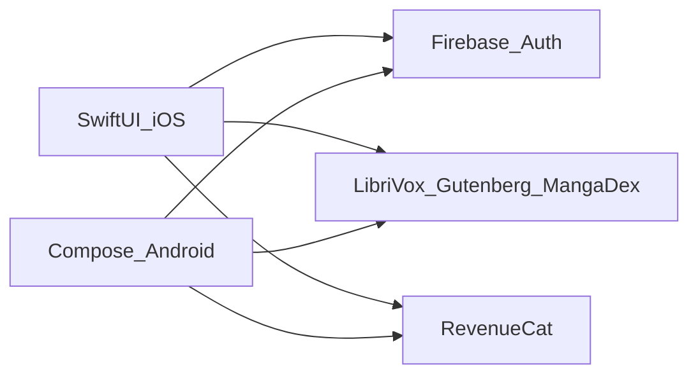

# Native Android app beside the iPhone app

The Xcode project cannot run on Android. Add a second app, `android/`, and leave [AudioBy/](AudioBy/) as the iOS source of truth. Both talk to the same public catalog (LibriVox, Gutenberg, MangaDex), the same Firebase project, and RevenueCat.

## What maps across

- Shell: Discover, Explore, Library, Activity, Settings, plus the ember mini player. Android uses a dark capsule bar with grey circles and a sliding ember selection, not iOS Liquid Glass.
- Palette stays paper `#fffcf2`, stone `#ccc5b9`, charcoal `#403d39`, ink `#252422`, ember `#eb5e28`.
- Playback: [AudioPlayerService.swift](AudioBy/Services/AudioPlayerService.swift) becomes Media3 ExoPlayer plus a MediaSession so audio continues in the background and on the lock screen. [NowPlayingManager.swift](AudioBy/Services/NowPlayingManager.swift) is the iOS equivalent.
- On-device narration: [TTSEngineService.swift](AudioBy/Services/TTSEngineService.swift) becomes Android `TextToSpeech`. Studio voices stay behind [ElevenLabsService.swift](AudioBy/Services/ElevenLabsService.swift) and the existing key.
- Catalog and progress: port [AudiobookRepository.swift](AudioBy/Services/AudiobookRepository.swift) and the models. The bundled SQLite catalog can be copied into the Android assets and read with SQLDelight.
- Auth: Firebase Auth on Android, plus Google Sign-In. Sign in with Apple is iOS-only and is not required on Android.
- Purchases: RevenueCat Android SDK, same entitlement tiers as [EntitlementService.swift](AudioBy/Services/EntitlementService.swift).
- Manga and PDF import come after the listener loop works. CBZ is a zip; PDF text extraction uses an Android PDF library, not the iOS PDFKit path in [UserImportService.swift](AudioBy/Services/UserImportService.swift).

## Build order

1. Gradle app `android/` (Kotlin, Compose, min SDK 26). Theme, splash, and the ember icon.
2. Firebase and Google sign-in, then email sign-in, so a listener can get into the shell.
3. Catalog list and book detail from the same endpoints the iOS app already calls.
4. ExoPlayer, chapter queue, mini player, and the full player. This is the milestone that makes it an audiobook app.
5. Library shelves, downloads, bookmarks, and listening stats.
6. Reader, on-device voice, PDF import, then manga.
7. RevenueCat paywall.

Do not start by porting every Swift file. Ship steps 1–4 before manga, car mode, or Android Auto.

## What you set up outside the code

- A Firebase Android app (`com.audioby.app`) and `google-services.json`.
- A RevenueCat Android app and a Play Console product linked to the same entitlement.
- A Play signing key when you are ready to upload. Emulator builds do not need that.
